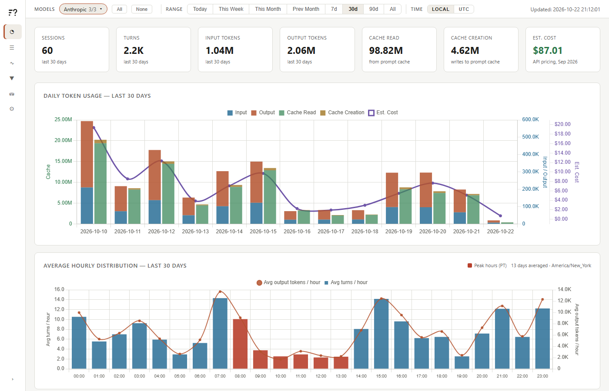
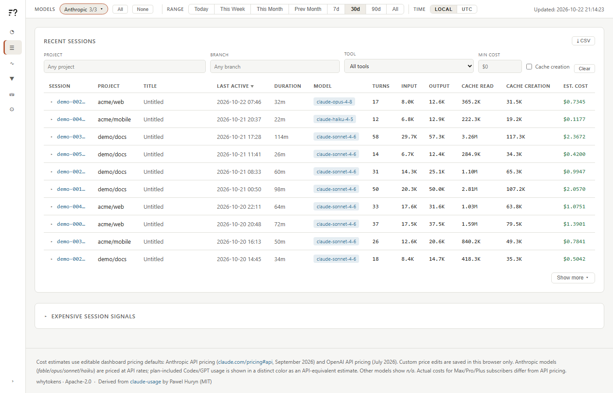
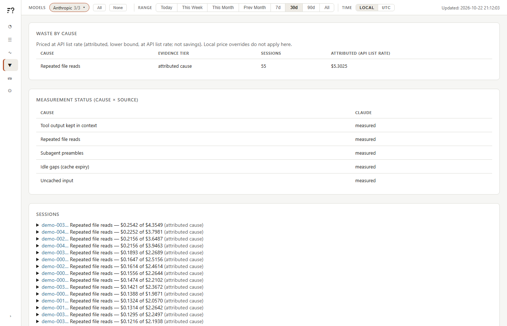
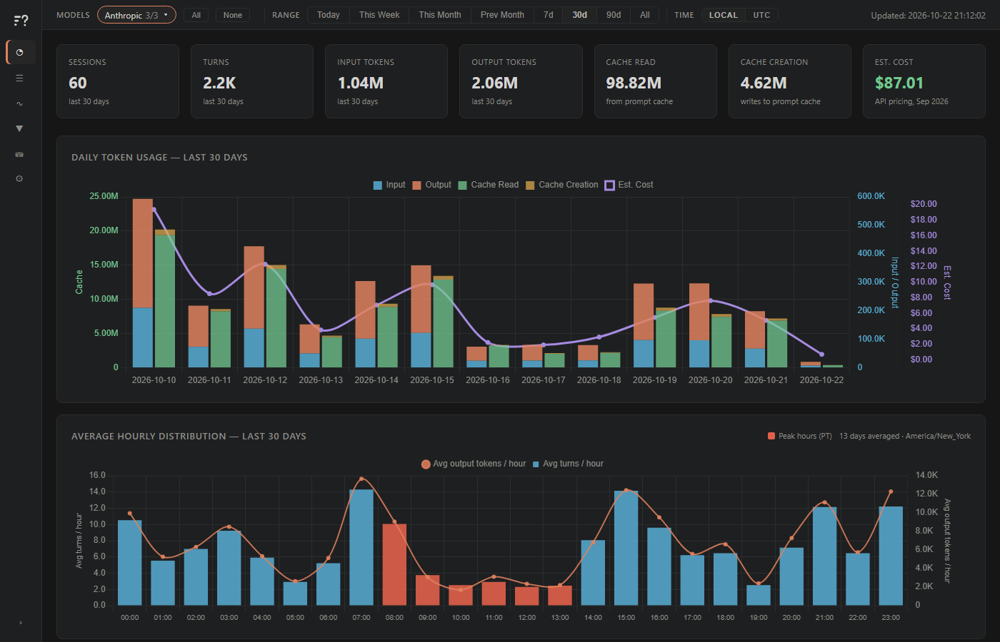

# whytokens

Where did your Claude Code and Codex tokens go, and why?

whytokens reads the transcript logs those tools already write on your machine, stores
per-turn token counts in a local SQLite database, and shows them in a browser dashboard
and a few CLI summaries. It also points at avoidable spend: repeated file reads, tool
output that stays in context, subagent preambles, idle gaps that expire the prompt cache,
and uncached input.



## What it reads

- Claude Code transcripts: `~/.claude/projects/**/*.jsonl`
- Codex CLI rollouts: `$CODEX_HOME/sessions/` (default `~/.codex/sessions/`)
- On macOS, Xcode's Claude agent transcripts: `~/Library/Developer/Xcode/CodingAssistant/ClaudeAgentConfig/projects/` (when present)

Nothing else, unless you opt in (see [docs/DATA_POLICY.md](docs/DATA_POLICY.md)). There is
no telemetry. Scanning and analysis make no outbound connections. The dashboard listens on
loopback only. The data policy lists exactly what is stored (token counts, timestamps,
model names, project and branch names, session titles, tool names; not prompts, file
contents or shell commands) and how to delete it.

Costs are API-equivalent estimates computed from public list prices. They are not your
bill, and on a subscription plan you pay something different.

## Install and run

Requires Python 3.9 or newer. No third-party dependencies.

```sh
# one-off, no install
uvx --from git+https://github.com/whytokens/whytokens@v0.1.0 whytokens dashboard

# or install the command
pipx install git+https://github.com/whytokens/whytokens@v0.1.0
whytokens dashboard

# or from a clone
git clone https://github.com/whytokens/whytokens
cd whytokens
python cli.py dashboard       # python3 on macOS/Linux
```

`dashboard` scans your logs, then serves http://localhost:8090 and opens it in a browser.

## Screens

| Screen | Shows |
|---|---|
| Overview | Totals, daily token usage with estimated cost, hourly distribution, projects, tools |
| Sessions | Filterable session table with cost, model, tokens; expensive-session signals; CSV export |
| Trace | One session turn by turn |
| Waste | Spend attributed to avoidable causes, per session, with a fix for each |
| Sources | Which log locations were found and how many sessions came from each |
| Settings | Editable price table, timezone, theme |

Light and dark themes follow the OS unless you pick one.





The screenshots are generated from synthetic transcripts (`scripts/demo_corpus.py`).

## CLI

Each command below can be run as `whytokens <command>` or `python cli.py <command>`.

| Command | Does |
|---|---|
| `scan [--projects-dir PATH]` | Parse logs into the database (incremental) |
| `scan --doctor` / `doctor` | Report schema drift in the logs; writes nothing |
| `today` | Today's usage by model |
| `week` | Last 7 days, per day and by model |
| `stats` | All-time statistics |
| `live [--session ID] [--cwd PATH] [--json]` | Current session's cost, context and tokens straight from its transcript, no database |
| `waste [--session ID]` | Avoidable-spend findings with a concrete fix each |
| `dashboard [--projects-dir PATH] [--host HOST] [--port PORT] [--no-browser] [--unsafe-host]` | Scan, then serve the dashboard |

`--projects-dir` overrides only the Claude location. Binding to anything other than
loopback needs `--unsafe-host`.

## Configuration

| Variable | Effect |
|---|---|
| `WHYTOKENS_HOME` | Data directory (default `~/.whytokens`) |
| `WHYTOKENS_DB` | Database file (default `<home>/whytokens.db`) |
| `WHYTOKENS_EXTRA_PROJECTS_DIRS` | Extra Claude transcript roots, `;` or `,` separated |
| `CODEX_HOME` | Codex home (default `~/.codex`) |
| `PORT`, `HOST` | Dashboard port (default 8090) and host (default `localhost`) |
| `WHYTOKENS_STORE_RAW_INPUTS=1` | Store full tool inputs; off by default |
| `WHYTOKENS_DESKTOP_CACHE=1` | Read Claude desktop app thread titles from its local cache; off by default |
| `WHYTOKENS_EXTENSIONS` | Extension directories (`os.pathsep`-separated); see [docs/EXTENSIONS.md](docs/EXTENSIONS.md) |

## Data location

`~/.whytokens/whytokens.db` (plus `-wal` and `-shm` files). Delete it to start over; it is
rebuilt from the transcripts that still exist. The schema and the read API the dashboard
serves are in [docs/SCHEMA.md](docs/SCHEMA.md).

## Limits

- Estimates only. Prices are list prices in a table you can edit in Settings; unknown
  models show `n/a`.
- Waste figures are lower bounds attributed to a cause, not savings you are guaranteed.
- You see what the logs contain. History a tool has already pruned is gone.
- Log formats are not a stable API. `scan --doctor` reports fields or versions the
  parser has not seen.

## Tests

```sh
python -m unittest discover -s tests
```

## Licence and credit

Apache-2.0, see [LICENSE](LICENSE) and [NOTICE](NOTICE).

Derived from [claude-usage](https://github.com/phuryn/claude-usage) by Paweł Huryn
(MIT); see [NOTICE](NOTICE) and [VENDORED.md](VENDORED.md). Not affiliated with
Anthropic or OpenAI; "Claude" and "Codex" are their trademarks.
